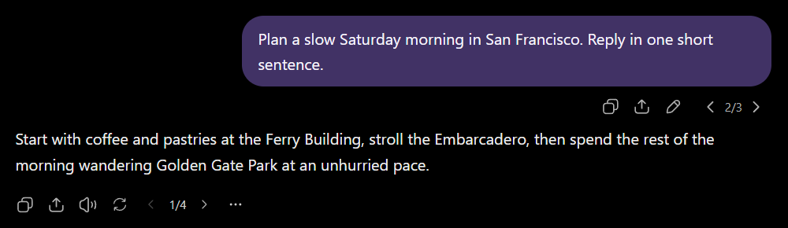

# ChatGPT Version Arrows

This Chrome extension restores the previous/next version arrows for edited messages and regenerated responses, so you can switch between versions directly in the conversation. Works with both ChatGPT's classic web client and the newer AppShell client.

  

> [!IMPORTANT]
> **AppShell remembers your selected branch.** Switching versions uses the client’s native navigation, which saves the selected branch on the server even without sending a message. Unlike in the classic client, this selection persists when you reopen the chat or use another device. Before leaving, switch back to the branch you want to keep active.

## Download and Install

1. On this GitHub page, click the **Code** button above the file list.
2. Click **Download ZIP**.
3. When the download finishes, open your Downloads folder.
4. Right-click the downloaded ZIP file and select **Extract All**.
5. Move the extracted `chatgpt-version-arrows-main` folder to a permanent location where you will not delete or move it later.
6. Open the extracted folder and make sure it contains `manifest.json`, `patch.js`, `app-shell-pagination.js`, and `app-shell-pagination.css`.
7. Open Chrome and enter `chrome://extensions` in the address bar.
8. Enable **Developer mode** in the top-right corner.
9. Click **Load unpacked**.
10. Select the extracted folder that directly contains `manifest.json`. Do not select the ZIP file, the `assets` folder, or a parent folder.
11. Make sure the extension appears on the Extensions page and is enabled.
12. Reload every open ChatGPT tab with `F5`.

> Keep the extracted folder after installation. Chrome loads the extension directly from that location. If you delete, rename, or move the folder, the extension may stop working and will need to be loaded again.

If Chrome reports that the manifest is missing or unreadable, you selected the wrong folder. Select the folder that directly contains `manifest.json`.

## Changelog

### 0.6.3

- Adds user-prompt editing to Work conversations in AppShell.
- Shows the model and reasoning effort, when available, in assistant-message menus in AppShell.

### 0.6.2

- Updated for AppShell's changed conversation loading. The extension now uses ChatGPT's native full-history loader to retrieve all message versions and restore their previous/next arrows, instead of relying on the former batch response.

### 0.6.0 — AppShell support

ChatGPT is rolling out a new client framework called **AppShell** alongside the classic web client. AppShell is the shared application shell around conversations, navigation, tabs, and panels. It uses a different conversation-loading and state model, so the classic config patch alone cannot restore the previous/next version arrows there.

This version adds AppShell support while preserving the existing classic-client behavior:

- Previous/next version arrows are restored for edited user messages and regenerated assistant responses.
- The experimental **See versions** / **Branch in new chat** interface is suppressed in AppShell.

## Known Limits

- ChatGPT client updates may require a corresponding extension update.
- In very long conversations, version arrows may take time to appear while the full history loads.
- Version arrows for edits of the first user message are not restored in the classic client.

For the technical details, see [How It Works](HOW_IT_WORKS.md).
