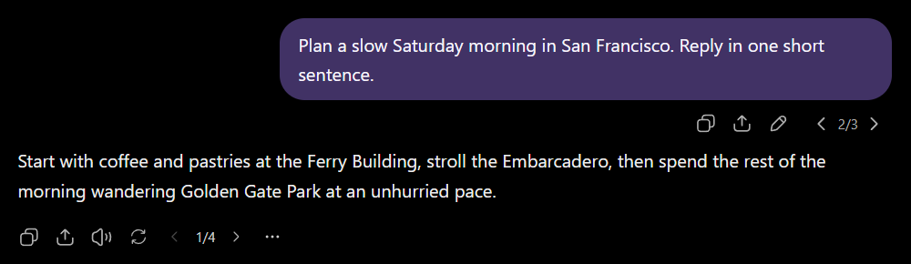

# ChatGPT Version Arrows

  

This Chrome extension restores the previous/next version arrows for edited prompts and regenerated replies, and adds a full conversation graph.

ChatGPT uses lazy loading for long conversations by default. This extension loads the full conversation history with all branches for the version arrows, and the graph uses that same data.

*May the Omnissiah bless your RAM.*

> [!IMPORTANT]
> **The new ChatGPT web client (AppShell) remembers your selected branch.** Switching versions uses the client’s native navigation, which saves the selected branch on the server even without sending a message. Unlike in the classic client, this selection persists when you reopen the chat or use another device. Before leaving, switch back to the branch you want to keep active.

## Download and Install

1. On this GitHub page, click the **Code** button above the file list.
2. Click **Download ZIP**, then extract the downloaded archive.
3. Keep the extracted `chatgpt-version-arrows-main` folder in a permanent location where you won't move or delete it.
4. Open Chrome and enter `chrome://extensions` in the address bar.
5. Enable **Developer mode** in the top-right corner, then click **Load unpacked**.
6. Select the extracted folder that directly contains `manifest.json`. Do not select the ZIP file or a parent folder.
7. Reload every open ChatGPT tab with `F5`.

## Changelog

### 0.7.0 Conversation Graph (AppShell)

To open the graph, click the **sidebar icon in the top-right corner of the conversation**.

- Full conversation graph with all user messages, assistant responses, and branches.
- Highlighting for the selected message and the current branch.
- Search across all branches and jump to matching messages in the graph.
- Expandable, resizable message previews with dates and model information when available.
- **Go to message** jumps to any message shown in the graph. It switches to that branch if needed and saves your selection on the server.
- Resizable right sidebar, with an option to expand the graph to the full workspace.
- Zoom with the mouse wheel or buttons, use **Zoom to fit**, pan the graph, or navigate with the interactive minimap.
- Export the full conversation tree as JSON, or the current branch as JSON or clean text with `USER` and `ASSISTANT` labels. Export is available once the full history has loaded and the chat is idle.

### 0.6.3

- Adds user-prompt editing to Work conversations in AppShell.
- Shows the model and reasoning effort, when available, in assistant-message menus in AppShell.

### 0.6.2

- Updated for AppShell's changed conversation loading. The extension now uses ChatGPT's native full-history loader to retrieve all message versions and restore their previous/next arrows, instead of relying on the former batch response.

### 0.6.0 AppShell support

When 0.6.0 was released, ChatGPT was rolling out **AppShell** alongside the classic web client. AppShell is the shared application shell around conversations, navigation, tabs, and panels. It uses a different conversation-loading and state model, so the classic config patch alone cannot restore the previous/next version arrows there.

This release added AppShell support while preserving the existing classic-client behavior:

- Previous/next version arrows are restored for edited user messages and regenerated assistant responses.
- The experimental **See versions** / **Branch in new chat** interface is suppressed in AppShell.

## Known Limits

- ChatGPT client updates may require a corresponding extension update.
- In very long conversations, version arrows may take time to appear while the full history loads.
- Version arrows for edits of the first user message are not restored in the classic client.

For the technical details, see [How It Works](docs/HOW_IT_WORKS.md).
